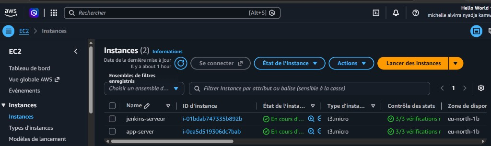
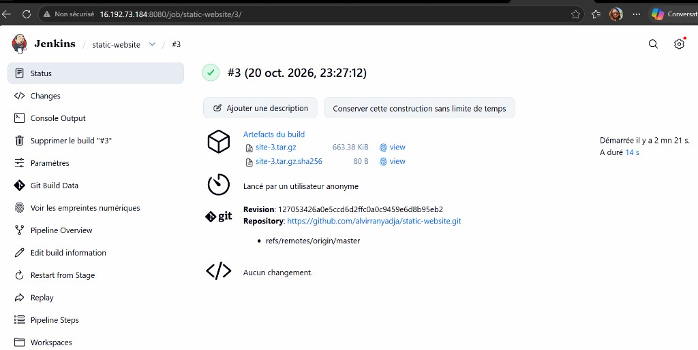
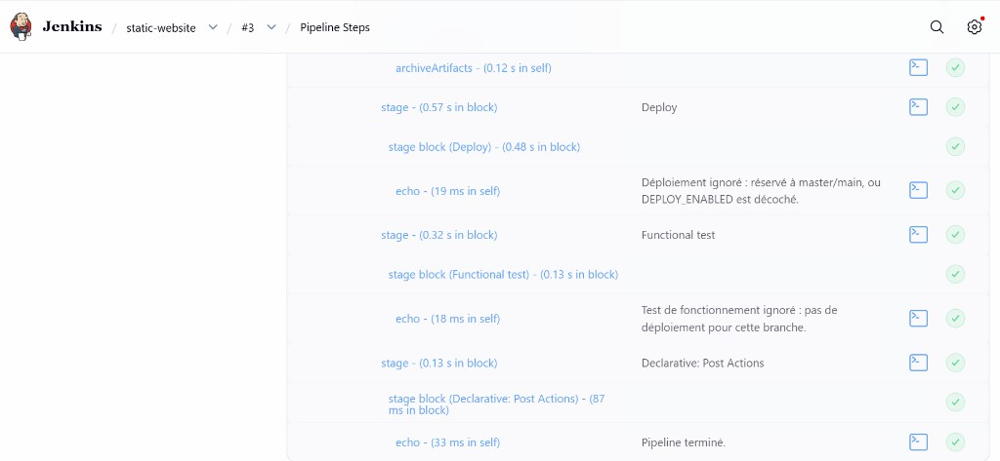
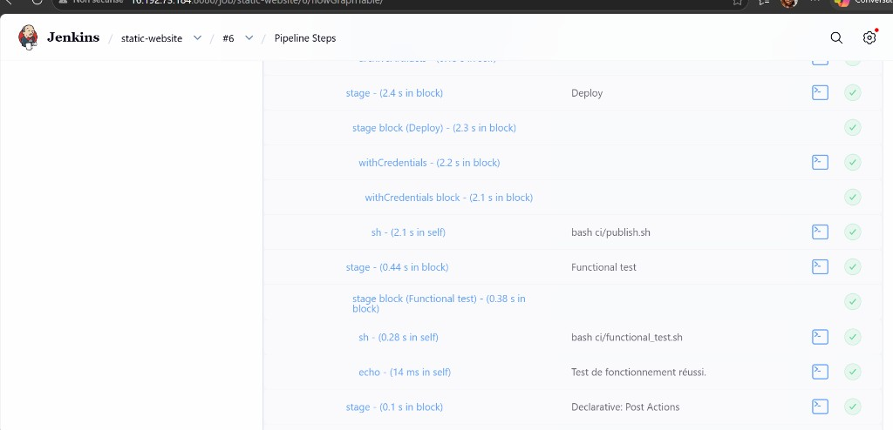
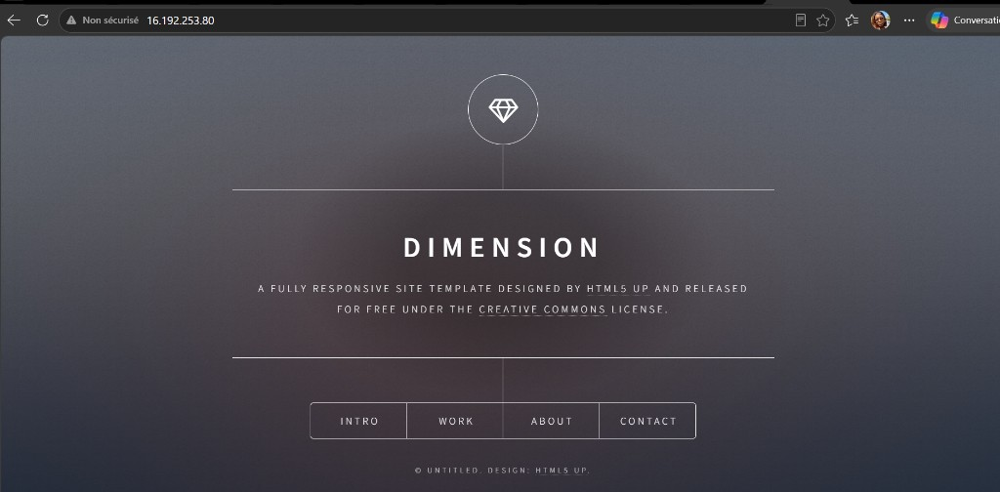

# Site statique — pipeline Jenkins

Site statique Dimension, construit, testé et publié par Jenkins.

Le code est sur [github.com/alvirranyadja/static-website](https://github.com/alvirranyadja/static-website). Jenkins tourne sur `16.192.73.184`. Le site publié est sur [http://16.192.253.80](http://16.192.253.80).

## Architecture

Deux machines EC2 `t3.micro`, dans `eu-north-1` :

| Instance | Rôle |
| --- | --- |
| `jenkins-serveur` | Jenkins, build et tests |
| `app-server` | nginx, site visible par les visiteurs |



Jenkins lit ce dépôt, produit une archive, puis l’envoie en SSH au compte `deploy` sur `app-server`. nginx sert le dossier `/var/www/static-website/current`.

## Étapes du pipeline

Le `Jenkinsfile` charge la bibliothèque partagée du dépôt (`vars/`, `src/`, `resources/`) et enchaîne :

1. **Checkout** — récupère `master`.
2. **Build** — assemble `dist/build` et écrit `build-info.json`.
3. **Acceptance** — sept contrôles : sections, formulaire, page 404, médias, manifeste, fichiers publiés, liens.
4. **Security** — secrets, hôtes autorisés, clé SSH épinglée, en-têtes nginx, sudo limité au rechargement.
5. **Package** — archive `dist/site-<build>.tar.gz` et empreinte SHA-256.
6. **Archive** — conserve l’archive dans Jenkins.
7. **Deploy** — copie l’archive sur `16.192.253.80`, bascule la release, recharge nginx. Cette étape est ignorée si `DEPLOY_ENABLED` est décoché.
8. **Functional test** — vérifie la page, le CSS, l’image de fond, la page 404 et les en-têtes. En cas d’échec, Jenkins revient à la release précédente.

## Contrôle sans déploiement

Le build **#3** a été lancé avec `DEPLOY_ENABLED` décoché. Il vérifie la chaîne jusqu’à l’archive, sans toucher au serveur web.

L’archive `site-3.tar.gz` et son empreinte `site-3.tar.gz.sha256` sont conservées dans Jenkins.



Les étapes Deploy et Functional test sont vertes, mais leur journal indique qu’elles n’ont rien publié.



## Déploiement

Le build **#6** a été lancé avec `DEPLOY_ENABLED` coché. Jenkins a utilisé le credential `deploy-ssh-key`, exécuté `ci/publish.sh`, puis `ci/functional_test.sh`. Le journal se termine par « Test de fonctionnement réussi ».



Le site servi par `app-server` est la page Dimension.



## Relancer une publication

1. Pousser les changements sur `master`.
2. Ouvrir le job `static-website` dans Jenkins.
3. Lancer **Build with Parameters**.
4. Laisser `DEPLOY_HOST` à `16.192.253.80`, `SITE_URL` à `http://16.192.253.80` et `SSH_CREDENTIALS_ID` à `deploy-ssh-key`.
5. Cocher `DEPLOY_ENABLED` pour publier. Le décocher pour s’arrêter après l’archive.

La préparation initiale de `app-server` se fait une fois, en root :

```bash
sudo bash deploy/bootstrap-deploy-host.sh
```

La clé publique de Jenkins doit être dans `/home/deploy/.ssh/authorized_keys`. La clé privée est le credential Jenkins `deploy-ssh-key`, utilisateur `deploy`.

## Licence

Ce site reprend le modèle Dimension de [HTML5 UP](https://html5up.net/), sous [licence Creative Commons Attribution 3.0](https://html5up.net/license).
